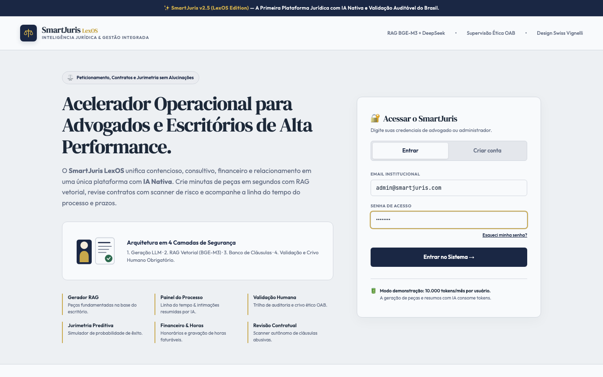

# 📘 Tutorial — SmartJuris (sistema jurídico com IA)

> Tutorial visual gerado automaticamente com **Playwright** sobre dados de **demonstração (fakes)**.
> Nenhum dado real foi capturado.

## 🚀 Como acessar

1. Suba o ambiente local: `pnpm dev` (API em `http://localhost:3001`, Web em `http://localhost:5173`).
2. Abra `http://localhost:5173` no navegador.
3. Entre com as credenciais de demonstração:

| Perfil | E-mail | Senha |
|---|---|---|
| Administrador | `admin@smartjuris.com` | `admin123` |
| Usuário | `user@smartjuris.com` | `user123` |

> ⚠️ Todas as telas usam **dados fake** de demonstração — nada aqui é um caso real.

## 🧭 Navegação

A navegação é feita pela **barra lateral** (sidebar). O painel principal abre no **Painel (Dashboard)** após o login.

### Login

Digite o e-mail institucional e a senha de acesso e clique em **Entrar no Sistema →**.

## 📂 Módulos

### Painel (Dashboard)

Visão geral do escritório: KPIs, peças recentes e prazos críticos.

### Agenda

Agenda de audiências, reuniões e prazos — clique em uma data para adicionar um evento.

### Processos

Gestão de processos: cadastre, edite e acompanhe o andamento de cada caso com linha do tempo.

### Clientes

Cadastro de clientes PF/PJ com máscaras de CPF/CNPJ e busca automática de CEP.

### Gerar Peças

Gerador de peças com IA: escolha o tipo, descreva o caso e gere a petição (RAG + jurisprudência ao vivo).

### Validação

Fila de validação humana: revise e aprove as peças geradas pela IA antes de protocolizar.

### Jurimetria

Analytics de taxa de êxito por área e calculadora preditiva de risco.

### Decisões & Tribunais

Consulta ao vivo de jurisprudência (busca por termo e por número) via Jurisprudências.ai.

### Financeiro

Honorários, despesas e timesheet faturável (horas billable).

### Revisão Contratual

Scanner autônomo de minutas: detecção de riscos e sugestões de redação.

### CRM & Funil

Funil de vendas: Lead → Diagnóstico → Proposta → Contrato.

### Base RAG

Base de conhecimento vetorial (RAG): coleções indexadas e busca semântica.

### Documentação

Central de ajuda: manual em 3 passos, arquitetura, LGPD e FAQ.

### Administração

Administração do escritório: identidade/timbre, métricas, usuários e permissões.

## 💡 Dicas rápidas

- **Gerar Peças**: descreva o caso, ative a busca de jurisprudência e gere com IA — depois revise em **Validação**.
- **Processos**: cadastre processos e acompanhe intimações resumidas por IA na linha do tempo.
- **Decisões & Tribunais**: busque jurisprudência ao vivo e envie a citação direto para o gerador de peças.
- **Financeiro**: registre honorários e use o cronômetro de timesheet para horas faturáveis.
- **Base RAG**: indexe documentos do escritório para fundamentar as peças com a base interna.

---
*Gerado em 2026-08-23 · Playwright + SmartJuris · dados de demonstração.*
